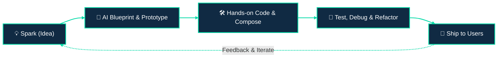

<div align="center">

<!-- Hero Banner -->


<!-- Animated Typing Subtitle -->
<a href="https://git.io/typing-svg">
  
</a>

<br/>

<!-- Social Badges -->
<p align="center">
  <a href="https://github.com/Tombytee">
    
  </a>
  <a href="https://x.com/imxubhh">
    
  </a>
  <a href="https://www.threads.net/@tombytee">
    
  </a>
  <a href="https://www.instagram.com/imxubhh/">
    
  </a>
</p>

<!-- Quick Navigation Pills -->
<p align="center">
  <a href="#about-me"></a>
  <a href="#featured-projects"></a>
  <a href="#tech-stack"></a>
  <a href="#how-i-build"></a>
  <a href="#github-insights"></a>
  <a href="#connect-with-me"></a>
</p>

</div>

---

###  About Me

```javascript
const tombytee = {
  name: "Subham",
  alias: "Tombytee",
  role: "Indie Developer & Digital Product Builder",
  crafting: ["Android Apps", "Utility Web Platforms", "Automations"],
  stackMindset: "AI-assisted velocity + Deep manual debugging",
  exploring: ["Generative AI APIs", "Modern Kotlin / Compose", "Open-Source Tooling"],
  motto: "Learn · Build · Experiment · Improve"
};
```

> *"I don't believe learning stops at passive tutorials. I prefer building, breaking, fixing, and scaling real-world solutions."*

---

###  Featured Projects

<table>
  <tr>
    <td width="50%" valign="top">
      <h3>📎 ClipNest</h3>
      <p><b>Your clipboard, finally organized.</b></p>
      <p>A smart, privacy-first Android clipboard manager that archives clips and keeps your copy history searchable and neatly sorted.</p>
      <p>
        
        
      </p>
      <p>
        <a href="https://github.com/Tombytee/ClipNest-App"><b>📦 View Source Code »</b></a>
      </p>
    </td>
    <td width="50%" valign="top">
      <h3>📋 KamKaaj</h3>
      <p><b>Everyday paperwork, simplified.</b></p>
      <p>An offline-first Android solution for household records: rent receipts, appliance warranties, insurance docs, and EMI alerts built specifically for Indian families.</p>
      <p>
        
        
      </p>
      <p>
        <a href="https://github.com/aiwebnix-oss/kamkaaj"><b>📦 View Source Code »</b></a>
      </p>
    </td>
  </tr>
  <tr>
    <td width="50%" valign="top">
      <h3>🌐 OX MODZ</h3>
      <p><b>Centralized hub for digital utilities.</b></p>
      <p>A curated resource repository and directory powered by Firebase cloud infrastructure with clean categorizations.</p>
      <p>
        
        
      </p>
      <p>
        <a href="https://oxmodz.page.gd/"><b>🔗 Live Demo »</b></a> &nbsp;|&nbsp; 
        <a href="https://github.com/aiwebnix-oss/ox-modz"><b>📦 Source »</b></a>
      </p>
    </td>
    <td width="50%" valign="top">
      <h3>♻️ ReUseX</h3>
      <p><b>Your waste, someone's urgent need.</b></p>
      <p>A circular sustainability initiative for donating, swapping, repairing, and recycling physical items with an integrated hyper-local Need Board.</p>
      <p>
        
        
      </p>
      <p>
        <i>🚧 In design & architecture phase</i>
      </p>
    </td>
  </tr>
</table>

---

###  Tech Stack & Tools

<div align="center">

<!-- Skill Icons Unified Dark Shelf -->
<a href="https://skillicons.dev">
  
</a>

<br/><br/>

<!-- Modern Pill Badges matching palette -->


</div>

---

###  How I Build



- ⚡ **Rapid Prototyping:** AI se boilerplate aur structural prototype tezi se banana.
- 🎨 **UI/UX Crafting:** Jetpack Compose & modern web components ke sath visual polish.
- 🔁 **Deep Debugging:** Code generated ho ya manual, edge cases aur crashes khud test & solve karna.
- 📦 **Ship Early, Iterate Fast:** Sirf tutorials nahi, live feedback par product ko evolve karna.

---

###  GitHub Insights

<div align="center">

<!-- Dynamic GitHub Stats Cards with Custom Teal/Navy Theme -->


<br/><br/>

<!-- Realtime Badges -->
<a href="https://github.com/Tombytee?tab=followers">
  
</a>
<a href="https://github.com/Tombytee/ClipNest-App/stargazers">
  
</a>
<a href="https://github.com/Tombytee/ClipNest-App/commits">
  
</a>

<br/><br/>

<!-- Contribution Snake Animation -->
<picture>
  <source media="(prefers-color-scheme: dark)" srcset="https://raw.githubusercontent.com/Tombytee/Tombytee/output/github-snake-dark.svg" />
  <source media="(prefers-color-scheme: light)" srcset="https://raw.githubusercontent.com/Tombytee/Tombytee/output/github-snake.svg" />
  
</picture>

<br/><br/>

<a href="https://github.com/Tombytee?tab=repositories">
  
</a>

</div>

---

###  Connect With Me

<div align="center">

Got an idea, feedback, or want to collaborate on a product? Feel free to reach out!

<br/>

<a href="https://github.com/Tombytee">
  
</a>
<a href="https://x.com/imxubhh">
  
</a>
<a href="https://www.threads.net/@tombytee">
  
</a>
<a href="https://www.instagram.com/imxubhh/">
  
</a>

<br/><br/>

<sub><i>Building today. Learning every day. ✨</i></sub>

<br/><br/>

<!-- Animated Wave Footer -->


</div>
