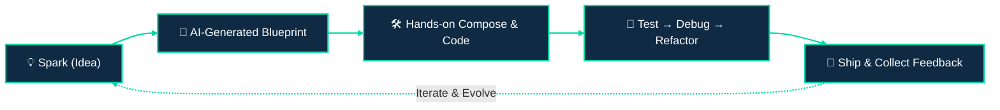

<div align="center">

<!-- ===========================  HERO BANNER =========================== -->


<!-- ===========================  TYPING SUB‑TITLE =========================== -->
<a href="https://git.io/typing-svg">
  
</a>

<br/>

<!-- ===========================  SOCIAL BADGES =========================== -->
<p align="center">
  <a href="https://github.com/Tombytee"></a>
  <a href="https://x.com/imxubhh"></a>
  <a href="https://www.threads.net/@tombytee"></a>
  <a href="https://www.instagram.com/imxubhh/"></a>
</p>

<!-- ===========================  QUICK NAVIGATION =========================== -->
<p align="center">
  <a href="#about-me"></a>
  <a href="#featured-projects"></a>
  <a href="#tech-stack"></a>
  <a href="#how-i-build"></a>
  <a href="#github-insights"></a>
  <a href="#connect-with-me"></a>
</p>

</div>

---  

## 🧑‍💻 **About Me**  

```javascript
const tombytee = {
  name: "Subham",
  alias: "Tombytee",
  role: "Indie Developer & Product Builder",
  builds: ["Android Apps", "Web Platforms", "Practical Tools"],
  mindset: "AI‑assisted prototyping → hands‑on debugging",
  exploring: ["Generative AI", "Jetpack Compose", "Open‑Source Ecosystems"],
  motto: "Learn · Build · Experiment · Improve"
};
```

> *“Learning stops when you stop building. I prefer to write code, break it, fix it, and ship real‑world solutions.”*  

---  

## 🚀 **Featured Projects**  

<table>
  <tr>
    <td width="50%" valign="top">
      <h3>📎 ClipNest</h3>
      <p><b>Your clipboard, finally organized.</b></p>
      <p>An **offline‑first Android clipboard‑history app** that saves every copied snippet, lets you search, tag, and export your clips.</p>
      <p>
        
        
        
      </p>
      <p>
        <a href="https://github.com/Tombytee/ClipNest-App"><b>🔎 Source Code »</b></a>
      </p>
    </td>
    <td width="50%" valign="top">
      <h3>📋 KamKaaj</h3>
      <p><b>Everyday paperwork, simplified.</b></p>
      <p>An **offline‑first Android app** for managing rent receipts, warranty cards, insurance policies, and EMI tracking – built for Indian households.</p>
      <p>
        
        
      </p>
      <p>
        <a href="https://github.com/aiwebnix-oss/kamkaaj"><b>🔎 Source Code »</b></a>
      </p>
    </td>
  </tr>
  <tr>
    <td width="50%" valign="top">
      <h3>🌐 OX MODZ</h3>
      <p><b>Central hub for curated digital resources.</b></p>
      <p>A **Firebase‑powered web portal** that collects and displays useful tools, tutorials, and utilities with a clean UI.</p>
      <p>
        
        
      </p>
      <p>
        <a href="https://oxmodz.page.gd/"><b>🔗 Live Demo »</b></a> | <a href="https://github.com/aiwebnix-oss/ox-modz"><b>🔎 Source »</b></a>
      </p>
    </td>
    <td width="50%" valign="top">
      <h3>♻️ ReUseX</h3>
      <p><b>Your waste, someone’s need.</b></p>
      <p>A **sustainability‑focused marketplace** for donating, swapping, repairing, and recycling items; includes a community “Need Board”.</p>
      <p>
        
        
      </p>
      <p><i>🚧 Still in design phase – stay tuned!</i></p>
    </td>
  </tr>
</table>

---  

## 🛠️ **Tech Stack & Tools**  

<div align="center">
  <a href="https://skillicons.dev">
    
  </a>
  <br/><br/>
  
  
  
  
</div>

---  

## 🔧 **How I Build**  



- **⚡ Rapid prototyping** – AI drafts UI, data models & boilerplate in seconds.  
- **🎨 UI polish** – Jetpack Compose + responsive web components give a modern look.  
- **🔁 Deep debugging** – Unit tests, UI tests, and manual inspection keep quality high.  
- **📦 Continuous delivery** – One‑click Firebase/App Hosting deploys, followed by rapid feedback loops.

---  

## 📈 **GitHub Insights**  

<div align="center">


<br/>

<a href="https://github.com/Tombytee?tab=followers">
  
</a>
<a href="https://github.com/Tombytee/ClipNest-App/stargazers">
  
</a>
<a href="https://github.com/Tombytee/ClipNest-App/commits">
  
</a>

<br/><br/>

<!-- Contribution Snake Animation (requires a GitHub Action that writes the SVG to the repo) -->
<picture>
  <source media="(prefers-color-scheme: dark)" srcset="https://raw.githubusercontent.com/Tombytee/Tombytee/output/github-snake-dark.svg" />
  <source media="(prefers-color-scheme: light)" srcset="https://raw.githubusercontent.com/Tombytee/Tombytee/output/github-snake.svg" />
  
</picture>

<br/>

<a href="https://github.com/Tombytee?tab=repositories">
  
</a>

</div>

---  

## 🤝 **Connect With Me**  

<div align="center">
  <a href="https://github.com/Tombytee"></a>
  <a href="https://x.com/imxubhh"></a>
  <a href="https://www.threads.net/@tombytee"></a>
  <a href="https://www.instagram.com/imxubhh/"></a>
</div>

> **Got an idea, feedback, or want to build something together?**  
> Drop a line, open an issue, or just say hello – I’m always up for a new challenge.  

<br/>

<sub><i>Building today. Learning every day. ✨</i></sub>

<br/>


