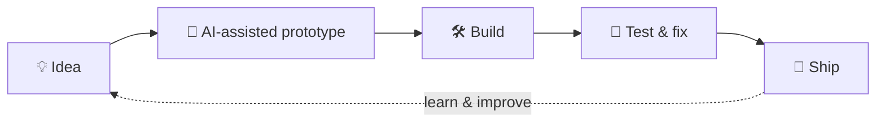

<div align="center">


<a href="https://github.com/Tombytee/Tombytee">
  
</a>

<br/>

<a href="https://github.com/Tombytee">
  
</a>
<a href="https://www.threads.net/@tombytee">
  
</a>
<a href="https://www.instagram.com/imxubhh/">
  
</a>
<a href="https://x.com/imxubhh">
  
</a>

<br/><br/>


<br/><br/>

[🚀 Projects](#-featured-projects) ·
[🧰 Tech Stack](#-tech-stack) ·
[⚙️ How I Build](#️-how-i-build) ·
[📊 Stats](#-github-at-a-glance) ·
[🌐 Connect](#-connect-with-me)

</div>

---

## 👨‍💻 About Me

```js
const tombytee = {
  name: "Subham",
  alias: "Tombytee",
  role: "Indie developer & project builder",
  building: ["Android apps", "Web projects", "Practical tools"],
  workflow: "AI-assisted development + hands-on debugging",
  exploring: ["AI", "Modern dev tools", "Open source"],
  motto: "Learn · Build · Experiment · Improve",
};
```

> I don't believe learning stops at tutorials. I prefer **building, testing, fixing, and improving** real projects.

---

## 🚀 Featured Projects

<table>
<tr>
<td width="50%" valign="top">

### 📎 ClipNest
**Your clipboard, organized.**

An Android clipboard-history app that saves what you copy and keeps it organized and easy to manage.


[](https://github.com/Tombytee/ClipNest-App)

</td>
<td width="50%" valign="top">

### 📋 KamKaaj
**Everyday work, made simpler.**

An offline-first Android app for managing household documents: rent receipts, warranty cards, insurance papers and EMI tracking, built for everyday Indian homes.


[](https://github.com/aiwebnix-oss/kamkaaj)

</td>
</tr>
<tr>
<td width="50%" valign="top">

### 🌐 OX MODZ
**A home for digital resources.**

A web project for presenting and organizing digital resources, with Firebase-powered functionality.


[](https://oxmodz.page.gd/)
[](https://github.com/aiwebnix-oss/ox-modz)

</td>
<td width="50%" valign="top">

### ♻️ ReUseX
**Your Waste, Someone's Need.**

A sustainability-focused concept built around selling, donating, repairing and recycling items, plus a community **Need Board**.


*No public repository yet.*

</td>
</tr>
</table>

---

## 🧰 Tech Stack

<div align="center">


<br/><br/>


</div>

---

## ⚙️ How I Build



- ⚡ **Rapid prototyping:** get a working version first, polish later
- 🎨 **UI & product experimentation:** try, compare, keep what feels right
- 🔁 **Iterative problem-solving:** every bug is a lesson
- 🌱 **Learning by building:** real projects over endless tutorials

---

## 📊 GitHub at a Glance

<div align="center">

<a href="https://github.com/Tombytee">
  
</a>
<a href="https://github.com/Tombytee">
  
</a>

<br/>


<br/><br/>


<br/><br/>

<picture>
  <source media="(prefers-color-scheme: dark)" srcset="https://raw.githubusercontent.com/Tombytee/Tombytee/output/github-snake-dark.svg" />
  <source media="(prefers-color-scheme: light)" srcset="https://raw.githubusercontent.com/Tombytee/Tombytee/output/github-snake.svg" />
  
</picture>

<br/><br/>

<a href="https://github.com/Tombytee?tab=repositories">
  
</a>

</div>

---

## 🌐 Connect With Me

<div align="center">

**Got an idea, feedback, or want to build something together? Say hi!**

<a href="https://github.com/Tombytee">
  
</a>
<a href="https://www.threads.net/@tombytee">
  
</a>
<a href="https://www.instagram.com/imxubhh/">
  
</a>
<a href="https://x.com/imxubhh">
  
</a>

<br/><br/>

*Building today. Learning every day.* ✨


</div>
